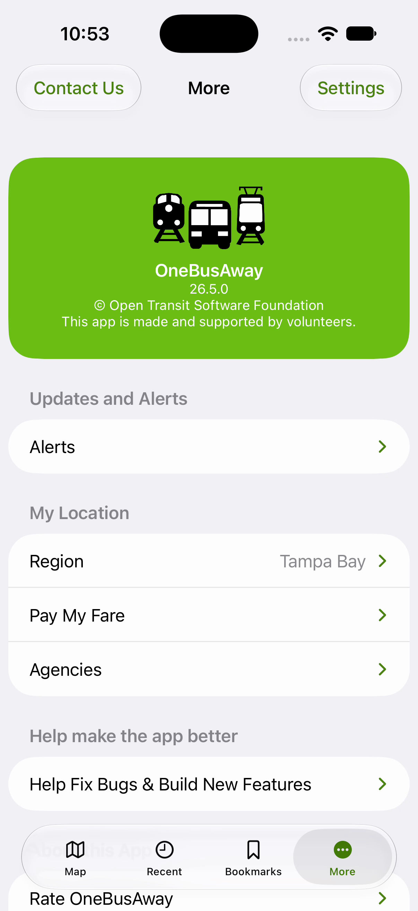

# Retired-region upgrade demo

Issue: https://github.com/OneBusAway/onebusaway-ios/issues/1763 (item 2).

Recorded on terminal-phone's dedicated iPhone 18 Pro simulator, iOS 27.2.

This is a simulated retirement, not a claim that Tampa's live service is retired. Both builds start with Tampa selected, automatic selection off, a saved successful list containing only Puget Sound and MTA New York, and no dropped-region record. The bundled list still contains Tampa.

The regions endpoint in the demo copies points to a refused local connection. No Mac network settings were changed. The source change does not alter the endpoint.

- Before: the failed refresh restores Tampa from the bundle. More shows Tampa Bay, even though the region picker lists only the two saved regions.
- After: Tampa stays unavailable after failed launch and manual refreshes. More has no selected region, and the picker has no selected row.

[Before recording](before-demo.mp4) (12 seconds, 2x speed).

[After recording](after-demo.mp4) (13 seconds, idle time removed and interaction segments at 1.4x speed; the last two seconds hold the final screenshot).

Both recordings have no audio and show only the app.

| Before | After |
| --- | --- |
|  |  |
