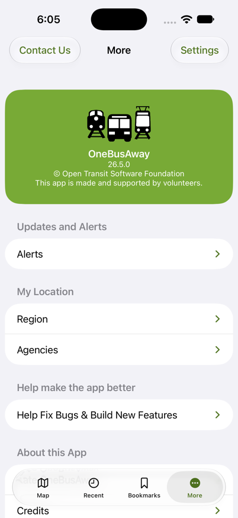

# Dropped-region automatic selection demo

Issue: https://github.com/OneBusAway/onebusaway-ios/issues/1770

Recorded on terminal-phone's iPhone 18 Pro simulator, iOS 27.2.

Both builds start with Tampa saved, automatic selection off, Tampa and Puget Sound marked dropped, no readable saved regions list, and a stale bundle containing only Puget Sound. A refused local regions endpoint keeps the list untrusted. These retirements are simulated. The production endpoint and bundle are unchanged.

Before: Puget Sound is selected again. After: it stays unselected and the chooser waits for a manual selection.

[Before video](before.mp4) and [after video](after.mp4), eight seconds each, app only, no audio.

| Before | After |
| --- | --- |
|  |  |
